  

  
  
  

## 👋 About me

- 🏢 Software Developer at **[IS del Norte](https://isdelnorte.com)**, Monterrey, Mexico
- 📱 I build **mobile apps** with Flutter and **web apps** with Next.js, end to end: UI, backend, deploys and store releases
- ☁️ Day to day with Firebase, Supabase, Vercel and AWS
- 🍎 On the side: small native macOS tools in Swift

## 🛠️ Tech stack

  <a href="https://skillicons.dev">
    
     
    
  </a>

## 🚀 Featured projects

<table>
  <tr>
    <td width="50%" valign="top">
      <h3><a href="https://github.com/jorgesoto98/nomusic">🎧 NoMusic</a></h3>
      Media keys open Spotify instead of Apple Music on macOS. Zero CPU, no SIP disable needed.
        
      
      
    </td>
    <td width="50%" valign="top">
      <h3><a href="https://github.com/jorgesoto98/qr-studio">🔳 QR Studio</a></h3>
      Customizable QR code generator: colors, dot styles and a center logo, all in the browser. <a href="https://jorgesoto98.github.io/qr-studio/">Try it live →</a>
        
      
      
    </td>
  </tr>
  <tr>
    <td width="50%" valign="top">
      <h3><a href="https://github.com/jorgesoto98/iphone-photo-backup">📸 iPhone Photo Backup</a></h3>
      Extract, organize and back up photos from iPhone backups on macOS and Linux.
        
      
    </td>
    <td width="50%" valign="top">
      <h3><a href="https://github.com/jorgesoto98/arcade-juegos">🕹️ Arcade</a></h3>
      A small collection of browser games with a main menu, starting with a sliding puzzle.
        
      
      
    </td>
  </tr>
</table>

## 🐍 Contributions

  <picture>
    <source media="(prefers-color-scheme: dark)" srcset="https://raw.githubusercontent.com/jorgesoto98/jorgesoto98/output/snake-dark.svg">
    <source media="(prefers-color-scheme: light)" srcset="https://raw.githubusercontent.com/jorgesoto98/jorgesoto98/output/snake.svg">
    
  </picture>

